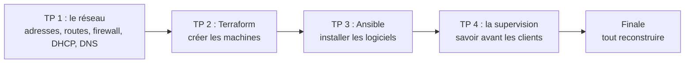

# INFAL103 : construire l'infrastructure de Hopla Market

Hopla Market vend en ligne. Tout tourne sur un seul PC, sous le bureau du comptable. En deux jours, nous allons construire son infrastructure, un incident à la fois.



## Démarrer (10 minutes, à faire une seule fois)
1. Connectez-vous à votre compte GitHub **personnel**.
2. Ouvrez ce lien : **https://codespaces.new/abdelhamidsbai/infal103-hopla**
3. Cliquez sur **Create codespace**, puis attendez la fin de l'installation : comptez environ 5 minutes.
4. Ouvrez un terminal (menu ☰ → Terminal → New Terminal), puis lancez :

```bash
bash labs/00-verifier.sh
```
- `bash` : lance un script.
- `labs/00-verifier.sh` : ce script vérifie que Docker, containerlab, Terraform et Ansible sont présents, et que Docker répond.

Vous devez lire : `Environnement prêt`.

**Comment lire le résultat :**

```text
OK      docker
OK      containerlab
OK      terraform
OK      ansible-playbook
OK      Docker répond

Environnement prêt.
```
Une ligne par outil vérifié. `MANQUE` à la place de `OK` veut dire que l'installation n'est pas terminée : attendez une minute, puis relancez le script.

## Lire un terminal
Vous n'avez jamais utilisé Linux ? Ce n'est pas un problème : voici le nécessaire.

- **L'invite** est le texte affiché avant votre commande. Elle indique où vous êtes. `poste:~#` veut dire que vous êtes dans la machine `poste`. Dans le Codespace, elle affiche le dossier où vous êtes.
- **Le silence est bon signe :** beaucoup de commandes n'affichent rien quand elles réussissent.
- **Une erreur se repère à ses mots :** `error`, `failed`, `not found`, `No such file`, `refused`.
- **Vous n'avez pas à tout lire :** chaque étape du TP dit quelles lignes regarder. Ignorez les autres.
- **Vos résultats ne seront pas identiques aux exemples :** les adresses MAC, les numéros et les durées changent à chaque fois. C'est normal.

| Pour... | Tapez |
|---|---|
| Aller dans un dossier | `cd nom-du-dossier` |
| Voir ce que contient le dossier | `ls` |
| Afficher un fichier | `cat nom-du-fichier` |
| Quitter une machine où vous êtes entré | `exit` |
| Arrêter une commande qui ne se termine pas | `Ctrl+C` |
| Retrouver la commande précédente | La flèche du haut |

Pour modifier un fichier, ouvrez-le dans l'explorateur de fichiers, à gauche de VS Code, puis enregistrez avec `Ctrl+S` (`Cmd+S` sur Mac).

## Lire les énoncés
Chaque TP explique ce que vous allez faire, puis le rôle de chaque commande. Les schémas s'affichent sur GitHub. Dans votre Codespace, ouvrez le fichier `README.md` du TP, puis faites `Ctrl+Maj+V` (`Cmd+Maj+V` sur Mac) pour afficher l'aperçu.

## Règles d'usage
- **Fin de séance :** arrêtez votre Codespace (☰ → *Stop Current Codespace*, ou depuis https://github.com/codespaces), pour préserver votre quota gratuit.
- **Reprise :** rouvrez le même Codespace depuis https://github.com/codespaces. Vos fichiers y sont toujours.
- **Fin du module :** supprimez votre Codespace, car il consomme votre quota même arrêté.

## Travailler sur votre PC (facultatif)
Le Codespace reste le chemin conseillé : c'est celui que nous suivons en cours. Pour travailler sur votre PC, il faut Docker en état de marche, et les ports `8080` et `3001` libres.

| Votre PC | Comment faire | TP possibles |
|---|---|---|
| Linux | Installez Docker, containerlab, Terraform et Ansible, puis lancez `bash labs/00-verifier.sh` | Tous |
| Windows ou Mac | Installez Docker Desktop et VS Code avec l'extension Dev Containers. Ouvrez le dépôt, puis choisissez **Reopen in Container** | Tous |
| Windows ou Mac, sans Dev Containers | Installez Docker Desktop, Terraform et Ansible | TP 2, 3 et 4 : containerlab, utilisé au TP 1, a besoin de Linux |

Dans les énoncés, les commandes `cd /workspaces/*/...` sont prévues pour le Codespace et Dev Containers. Sinon, remplacez `/workspaces/*` par le dossier du dépôt sur votre PC.

Si quelque chose bloque sur votre PC, repassez sur le Codespace : le formateur ne pourra pas dépanner chaque machine pendant le cours.

Un sigle inconnu ? Regardez le [glossaire](labs/glossaire.md).

## Les TP
Commencez un TP seulement quand le formateur l'annonce. Une diapo jaune « On passe au TP » indique le moment.

| Quand | TP | Durée | Fichier |
|---|---|---|---|
| Jour 1 | TP 1, acte 1 : explorer le réseau | 40 min | [labs/01-reseau](labs/01-reseau/README.md#acte-1--explorer-le-réseau) |
| Jour 1 | TP 1, acte 2 : protéger la compta | 40 min | [labs/01-reseau](labs/01-reseau/README.md#acte-2--protéger-la-compta) |
| Jour 1 | TP 1, acte 3 : le premier jour de Karim | 25 min | [labs/01-reseau](labs/01-reseau/README.md#acte-3--le-premier-jour-de-karim) |
| Jour 2 | TP 2 : recréer Hopla avec Terraform | 70 min | [labs/02-iac-terraform](labs/02-iac-terraform/README.md) |
| Jour 2 | TP 3 : configurer les serveurs avec Ansible | 35 min | [labs/03-ansible](labs/03-ansible/README.md) |
| Jour 2 | TP 4 : savoir avant les clients | 30 min | [labs/04-supervision](labs/04-supervision/README.md) |
| Jour 2 | Finale : tout reconstruire | 15 min | [labs/finale.md](labs/finale.md) |

Vous avez terminé en avance ? Regardez les [exercices bonus](labs/bonus.md).

## Si ça bloque
1. Relisez le message d'erreur à voix haute avec votre voisin.
2. Le TP donne une solution aux problèmes les plus courants.
3. Votre infrastructure est jetable : chaque TP explique comment repartir de zéro.
4. Appelez le formateur : c'est prévu.

Les conteneurs servent ici à simuler des machines sur tous les ordinateurs. Ce ne sont pas de vraies VM : un conteneur partage le noyau de l'hôte, alors qu'une VM a le sien.
