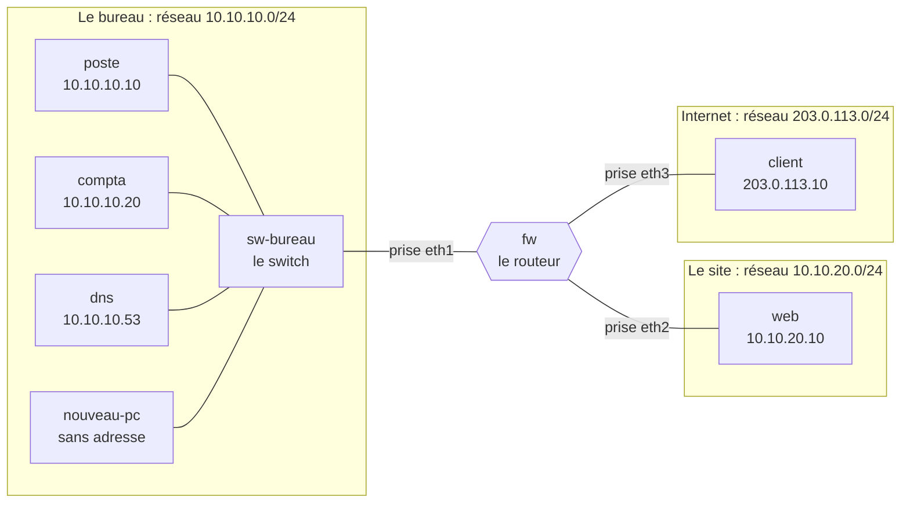
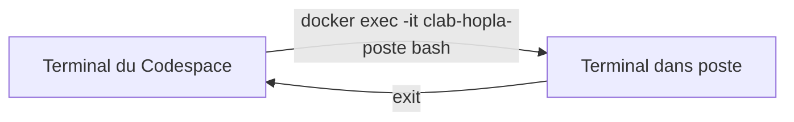
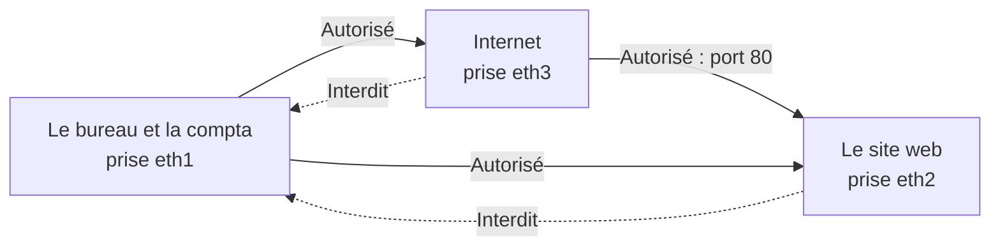
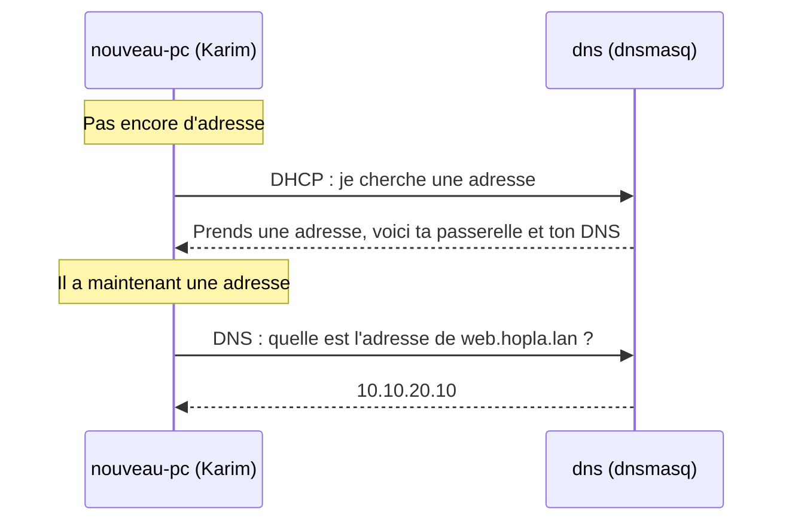

# TP 1 : le réseau de Hopla Market

## De quoi s'agit-il ?
Hopla Market grandit : un seul PC ne suffit plus. Nous allons explorer son réseau, le casser, le protéger, puis y accueillir un nouveau salarié.

Ce TP se fait en trois actes, répartis dans la journée. Le réseau reste allumé d'un acte à l'autre.

| Acte | Le problème | Ce que vous allez faire | Ce que vous saurez faire |
|---|---|---|---|
| 1 | Le site ne s'ouvre pas à l'accueil | Lire les adresses et les routes, casser une route, la réparer | Suivre le trajet d'un paquet |
| 2 | Depuis Internet, on lit les salaires | Écrire les règles du firewall, puis les tester | Traduire une matrice de flux en règles |
| 3 | Karim arrive, son poste n'a rien | Obtenir une adresse, demander un nom, couper le DNS | Distinguer le rôle du DHCP et du DNS |

## Le réseau du TP


Ces 8 machines sont simulées par des conteneurs Docker, et containerlab les relie entre elles. `sw-bureau` joue le rôle du switch du bureau. Le firewall et le site n'en ont pas besoin : ils ne sont que deux, reliés directement.

### Où tapez-vous vos commandes ?
Regardez toujours votre invite de commande : les mêmes mots n'ont pas le même effet selon la machine où vous êtes.



## Acte 1 : explorer le réseau
**Durée : 40 min. Incident :** à l'accueil, le site ne s'ouvre pas. Vous allez le reproduire, puis le réparer.

### 1. Démarrer le réseau
**Pourquoi :** rien n'existe encore. On demande à containerlab de créer les machines et les câbles décrits dans un fichier.

**Où :** dans le terminal du Codespace.
```bash
cd /workspaces/*/labs/01-reseau
sudo containerlab deploy -t hopla.clab.yml
```
- `cd /workspaces/*/labs/01-reseau` : se place dans le dossier du TP. Le `*` remplace le nom du dépôt.
- `sudo` : lance la commande avec les droits d'administrateur, nécessaires pour créer des interfaces réseau.
- `containerlab deploy` : démarre le réseau.
- `-t hopla.clab.yml` : indique le fichier qui décrit le réseau (`-t` pour *topology*).

**Vous devez voir :** un tableau de 8 machines, au bout d'une à deux minutes.

### 2. Entrer dans le poste d'accueil
**Pourquoi :** pour voir le réseau comme le voit le poste de l'accueil.

**Où :** dans le terminal du Codespace.
```bash
docker exec -it clab-hopla-poste bash
```
- `docker exec` : lance une commande dans une machine déjà démarrée.
- `-it` : garde la conversation ouverte, pour taper dans cette machine.
- `clab-hopla-poste` : le nom de la machine, soit `clab`, puis le nom du réseau `hopla`, puis `poste`.
- `bash` : la commande lancée, ici un terminal.

**Vous devez voir :** une nouvelle invite de commande, à l'intérieur de `poste`.

### 3. Lire son adresse et ses routes
**Pourquoi :** une machine a besoin de deux choses pour communiquer : une adresse, et des routes pour savoir où envoyer ses paquets.

**Où :** dans `poste`.
```bash
ip addr show eth1
ip route
```
- `ip addr show eth1` : affiche l'adresse de la prise réseau `eth1`.
- `ip route` : affiche la table de routage, c'est-à-dire le chemin à prendre selon la destination. Une ligne `A via B` se lit : pour aller vers A, passe par B.

**Vous devez voir :** `10.10.10.10/24`, puis une ligne `10.10.20.0/24 via 10.10.10.1`.

**Question :** par quelle passerelle le poste passe-t-il pour rejoindre le serveur web ?

Ignorez `eth0` : cette interface sert uniquement à faire fonctionner le laboratoire.

### 4. Tester la compta, puis le site
**Pourquoi :** avant de chercher une panne, on vérifie ce qui marche quand tout va bien.

**Où :** dans `poste`.
```bash
ping -c 2 10.10.10.20
curl -m 3 http://10.10.20.10
```
- `ping -c 2 10.10.10.20` : envoie 2 messages à la compta et attend sa réponse. `-c` donne le nombre de messages.
- `curl -m 3 http://10.10.20.10` : demande la page du site, comme un navigateur sans fenêtre. `-m 3` abandonne au bout de 3 secondes.

**Vous devez voir :** le ping répond, puis `Bienvenue chez Hopla Market`.

### 5. Lire le cache ARP du poste
**Pourquoi :** sur un câble, on se parle avec des adresses MAC (l'adresse de la carte réseau). ARP (Address Resolution Protocol) trouve la MAC à partir de l'adresse IP, et le poste garde les réponses dans un cache.

**Où :** dans `poste`.
```bash
ip neigh
```
- `ip neigh` : affiche les voisins connus du poste (*neighbours*), avec leur adresse IP et leur adresse MAC.

**Vous devez voir :** une ligne pour `10.10.10.20` et une pour `10.10.10.1`, chacune avec une adresse MAC après `lladdr`. Ignorez les lignes `eth0`.

**Question :** le poste vient de joindre le site `10.10.20.10`. Pourquoi sa MAC n'apparaît-elle pas ?

### 6. Suivre le trajet vers le site
**Pourquoi :** pour voir les étapes réelles d'un paquet, et non plus seulement la théorie.

**Où :** dans `poste`.
```bash
traceroute -n 10.10.20.10
```
- `traceroute` : affiche chaque routeur traversé jusqu'à la destination.
- `-n` : affiche les adresses, sans chercher les noms.

**Vous devez voir :** d'abord `10.10.10.1`, puis `10.10.20.10`.

### 7. Reproduire l'incident
**Pourquoi :** on retire la route vers le site, pour provoquer la panne de l'accueil et observer ce qui casse, et ce qui ne casse pas.

**Où :** dans `poste`.
```bash
ip route del 10.10.20.0/24 via 10.10.10.1
ping -c 2 10.10.10.20
curl -m 3 http://10.10.20.10
```
- `ip route del ...` : supprime le chemin vers le réseau du site. Le poste ne sait plus par où passer.
- `ping` et `curl` : les deux mêmes tests qu'à l'étape 4, pour comparer.

**Vous devez voir :** la compta répond toujours, et le `curl` vers le site échoue avec une erreur de connexion. Le poste ne sait plus comment rejoindre cette rue.

**Question :** pourquoi la compta marche-t-elle encore ?

### 8. Réparer
**Pourquoi :** on remet la route supprimée, puis on vérifie, puis on sort du poste.

**Où :** dans `poste`, puis retour au Codespace.
```bash
ip route add 10.10.20.0/24 via 10.10.10.1
curl -m 3 http://10.10.20.10
exit
```
- `ip route add ...` : remet le chemin : pour aller vers `10.10.20.0/24`, passer par `10.10.10.1`.
- `curl` : vérifie que le site répond de nouveau.
- `exit` : quitte `poste` et revient dans le terminal du Codespace.

**Vous devez voir :** `Bienvenue chez Hopla Market`.

### Avant le retour collectif
Expliquez à votre voisin, sans regarder vos notes, le trajet d'un paquet entre le poste et le site.

## Acte 2 : protéger la compta
**Durée : 40 min. Incident :** depuis Internet, n'importe qui lit les salaires.

**Ce que vous allez faire :** constater la fuite, tout interdire, puis rouvrir uniquement les flux prévus. Vous traduisez ainsi en règles la matrice remplie au tableau.



Rappel des prises du firewall :

| Prise de `fw` | Elle mène vers |
|---|---|
| `eth1` | le bureau et la compta |
| `eth2` | le site web |
| `eth3` | Internet |

### 1. Constater le problème
**Pourquoi :** on se met à la place d'un inconnu sur Internet, pour vérifier que la fuite existe avant de la corriger.

**Où :** dans le terminal du Codespace.
```bash
cd /workspaces/*/labs/01-reseau
docker exec clab-hopla-client curl -s -m 4 http://10.10.10.20
```
- `docker exec clab-hopla-client ...` : lance une seule commande dans la machine `client`, qui joue Internet, puis revient au Codespace. Sans `-it`, on n'y reste pas.
- `curl -s -m 4 http://10.10.10.20` : demande la page de la compta. `-s` n'affiche que le résultat, et `-m 4` abandonne au bout de 4 secondes.

**Vous devez voir :** `CONFIDENTIEL - salaires Hopla Market`.

### 2. Charger le fichier de règles tel quel
**Pourquoi :** le fichier fourni interdit tout, sauf les réponses aux connexions déjà ouvertes. On commence par voir l'effet de cette interdiction.

**Où :** dans le terminal du Codespace.
```bash
docker exec -i clab-hopla-fw nft -f - < firewall/regles.nft
bash firewall/tester.sh
```
- `< firewall/regles.nft` : envoie le contenu de ce fichier à la commande.
- `docker exec -i clab-hopla-fw` : lance la commande dans le firewall. `-i` lui permet de recevoir ce fichier.
- `nft -f -` : `nft` est l'outil qui pilote nftables, le firewall de Linux. `-f -` lit les règles dans ce qu'on lui envoie.
- `bash firewall/tester.sh` : essaie les 4 flux de la matrice, et indique pour chacun `BON` ou `A CORRIGER`.

**Vous devez voir :** Internet ne lit plus la compta, mais le site et le bureau sont coupés aussi. Tout est interdit par défaut : c'est le principe.

### 3. Compléter les règles
**Pourquoi :** il faut maintenant rouvrir ce qui est permis, et seulement cela.

Ouvrez `labs/01-reseau/firewall/regles.nft`. Enlevez le `#` devant les deux règles, puis remplacez les `?` en vous aidant du tableau et du schéma.

Pour lire ce fichier :

| Dans le fichier | Ce que cela veut dire |
|---|---|
| `policy drop` | Tout ce qui n'est pas autorisé est jeté |
| `ct state established,related accept` | Les réponses aux connexions déjà ouvertes peuvent revenir |
| `iifname "eth?"` | Le paquet entre par cette prise |
| `oifname "eth?"` | Le paquet sort par cette prise |
| `tcp dport ??` | Le paquet vise ce port |
| `accept` | Le paquet passe |

Ici, `fw` est un simple Linux, et le firewall, c'est `nftables` : pas besoin de boîtier. En entreprise, le même rôle est souvent tenu par un boîtier comme FortiGate ou par un logiciel comme pfSense.

Notre site de TP ne sert que le port 80 (HTTP) : c'est donc le seul à ouvrir. Un vrai site ouvrirait aussi le port 443 (HTTPS, le web chiffré), avec `tcp dport { 80, 443 } accept`.

### 4. Charger et tester
**Pourquoi :** une règle écrite dans un fichier ne fait rien tant qu'elle n'est pas chargée dans le firewall.

**Où :** dans le terminal du Codespace.
```bash
docker exec -i clab-hopla-fw nft -f - < firewall/regles.nft
bash firewall/tester.sh
```
Ce sont les deux mêmes commandes qu'à l'étape 2. Le fichier commence par `flush ruleset`, qui efface les anciennes règles : vous pouvez le recharger autant de fois que nécessaire.

**Vous devez voir :** `4 tests sur 4 sont bons`. Sinon, le script indique le flux à corriger : modifiez le fichier et relancez ces deux commandes.

**Question :** si le site est piraté, peut-il atteindre la compta ?

## Acte 3 : le premier jour de Karim
**Durée : 25 min. Incident :** Karim arrive, et son poste n'a ni adresse ni nom de serveur.

**Ce que vous allez faire :** demander une adresse au DHCP, demander l'adresse du site au DNS, puis couper le DNS pour voir ce qui casse.

La machine `dns` remplit les deux rôles, avec un seul logiciel : dnsmasq.



- **DHCP** (Dynamic Host Configuration Protocol) : distribue les adresses automatiquement.
- **DNS** (Domain Name System) : traduit un nom en adresse IP.

### 1. Entrer dans le poste de Karim
**Pourquoi :** pour constater l'état d'un poste qui vient d'être branché.

**Où :** dans le terminal du Codespace, puis dans `nouveau-pc`.
```bash
docker exec -it clab-hopla-nouveau-pc bash
ip addr show eth1
```
- `docker exec -it clab-hopla-nouveau-pc bash` : ouvre un terminal dans le poste de Karim.
- `ip addr show eth1` : affiche l'adresse de sa prise réseau.

**Vous devez voir :** aucune ligne `inet` sur `eth1`. Ce poste n'a pas d'adresse.

### 2. Demander une adresse
**Pourquoi :** Karim ne va pas configurer son poste à la main. Il le demande au serveur DHCP.

**Où :** dans `nouveau-pc`.
```bash
udhcpc -i eth1 -n -q
ip addr show eth1
```
- `udhcpc` : un petit client DHCP.
- `-i eth1` : fait la demande sur cette prise.
- `-n` : abandonne si personne ne répond, au lieu de réessayer sans fin.
- `-q` : s'arrête dès que l'adresse est obtenue.
- `ip addr show eth1` : vérifie l'adresse reçue.

**Vous devez voir :** une adresse entre `10.10.10.100` et `10.10.10.150`.

Seul ce poste passe par le DHCP. Le site, la compta et le DNS ont une adresse fixe : ce sont des serveurs, leurs clients doivent toujours les retrouver.

### 3. Demander l'adresse du site à partir de son nom
**Pourquoi :** Karim veut retenir un nom, pas une adresse.

**Où :** dans `nouveau-pc`, puis retour au Codespace.
```bash
dig +short @10.10.10.53 web.hopla.lan
exit
```
- `dig` : pose une question à un serveur DNS.
- `+short` : n'affiche que la réponse.
- `@10.10.10.53` : indique le serveur DNS à interroger.
- `web.hopla.lan` : le nom recherché.
- `exit` : revient dans le terminal du Codespace.

**Vous devez voir :** `10.10.20.10`.

### 4. Prendre un pari, puis casser le DNS
**Pariez :** si le DNS tombe, le poste d'accueil peut-il encore ouvrir le site ?

**Où :** dans le terminal du Codespace.
```bash
docker exec clab-hopla-dns pkill dnsmasq
docker exec clab-hopla-poste dig +short +time=2 +tries=1 @10.10.10.53 web.hopla.lan
docker exec clab-hopla-poste curl -s -m 3 http://10.10.20.10
```
- `pkill dnsmasq` : arrête le logiciel dnsmasq sur la machine `dns`.
- `dig ... +time=2 +tries=1` : pose la question depuis `poste`, attend 2 secondes, et n'essaie qu'une fois.
- `curl ... http://10.10.20.10` : demande le site directement par son adresse, depuis `poste`.

**Vous devez voir :** le nom ne répond plus (`no servers could be reached`), alors que le site répond toujours par son adresse.

### 5. Réparer, puis éteindre
**Pourquoi :** on relance le DNS, on vérifie, puis on rend les ressources du Codespace : le réseau de ce TP ne sert plus.

**Où :** dans le terminal du Codespace.
```bash
docker exec clab-hopla-dns dnsmasq --conf-file=/etc/dnsmasq.d/hopla.conf
docker exec clab-hopla-poste dig +short @10.10.10.53 web.hopla.lan
cd /workspaces/*/labs/01-reseau
sudo containerlab destroy -t hopla.clab.yml --cleanup
```
- `dnsmasq --conf-file=...` : relance dnsmasq avec son fichier de configuration.
- `dig` : vérifie que le nom répond de nouveau.
- `cd ...` : revient dans le dossier du TP.
- `containerlab destroy` : supprime les machines et les câbles.
- `--cleanup` : supprime aussi les fichiers que containerlab a créés pour ce réseau.

**Vous devez voir :** `10.10.20.10`, puis la suppression des machines.

## Si ça bloque
| Problème | Solution |
|---|---|
| `No such file or directory` sur `hopla.clab.yml` | Vous n'êtes pas dans le bon dossier : `cd /workspaces/*/labs/01-reseau` |
| Une commande `ip` ou `curl` n'existe pas | Vous n'êtes pas dans la bonne machine : tapez `exit`, puis entrez à nouveau |
| Le Codespace a été arrêté, ou tout est cassé | Repartir de zéro : `sudo containerlab deploy -t hopla.clab.yml --reconfigure` (`--reconfigure` recrée le réseau). Les règles du firewall sont alors à recharger |
| Une machine ne répond pas | Relancez la commande de démarrage ci-dessus |
