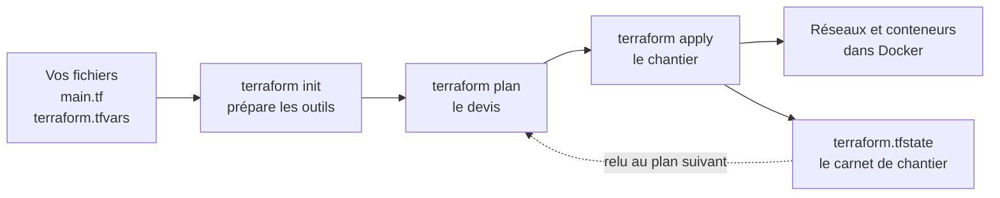
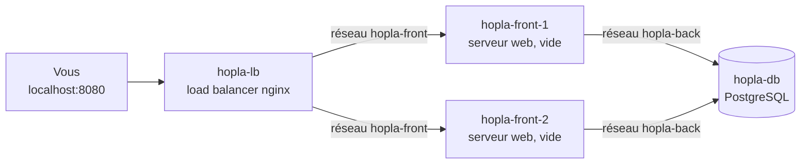

# TP 2 : recréer Hopla avec Terraform

**Durée : 70 min. Incident :** l'admin est parti, le serveur a brûlé, et personne ne sait comment il était installé.

## De quoi s'agit-il ?
Jusqu'ici, tout dépendait de ce que l'admin avait en tête. Nous allons décrire l'infrastructure de Hopla dans des fichiers texte, et laisser Terraform la construire. C'est l'Infrastructure as Code (IaC) : si tout brûle, on relance.

**Ce que vous allez faire :**
1. **Créer Hopla** à partir du code, en lisant d'abord ce que Terraform annonce.
2. **Modifier Hopla** en changeant une valeur : plus de mémoire, un serveur de plus.
3. **Trouver les limites** : ce que Terraform ne sait pas faire, et ce qu'il faut protéger.

Prenez votre temps : le but est de **lire ce que Terraform annonce**, pas d'aller vite.

**Où :** toutes les commandes de ce TP se tapent dans le terminal du Codespace.

## Comment Terraform travaille


| Fichier | Son rôle |
|---|---|
| `main.tf` | Décrit ce qui doit exister |
| `variables.tf` | Déclare les réglages possibles |
| `terraform.tfvars` | Donne la valeur de ces réglages |
| `outputs.tf` | Dit quoi afficher à la fin |
| `versions.tf` | Dit quels outils et quelles versions utiliser |
| `terraform.tfstate` | Mémorise ce que Terraform a créé. Il apparaît après le premier `apply` |

Ici, Terraform crée des conteneurs Docker, pour que le TP reste gratuit. Avec un autre fournisseur (*provider*), le même principe crée des VM chez AWS ou Azure.

## Partie 1 : créer Hopla

### 1. Lire le code
**Pourquoi :** avec Terraform, l'infrastructure se lit avant de se construire.

Ouvrez `labs/02-iac-terraform/main.tf`. Chaque bloc `resource` décrit une chose qui doit exister.

**Question :** combien de réseaux et de conteneurs ce fichier décrit-il ?

### 2. Préparer les outils
**Pourquoi :** Terraform doit télécharger les modules qui savent parler à Docker et écrire des fichiers.
```bash
cd /workspaces/*/labs/02-iac-terraform
terraform init
```
- `cd /workspaces/*/labs/02-iac-terraform` : se place dans le dossier du TP. Le `*` remplace le nom du dépôt.
- `terraform init` : télécharge ces modules dans le dossier `.terraform`. Il suffit de le faire une fois par dossier.

**Vous devez voir :** `Terraform has been successfully initialized!`

### 3. Lire le devis
**Pourquoi :** on veut savoir ce qui va se passer avant que cela arrive.
```bash
terraform plan
```
- `terraform plan` : compare le code à ce qui existe, puis annonce les changements, sans rien toucher. `+` veut dire créer, `~` modifier, `-` détruire, et `-/+` détruire puis recréer.

**Vous devez voir :** `Plan: 10 to add, 0 to change, 0 to destroy.` Rien n'a encore été créé.

### 4. Lancer le chantier
**Pourquoi :** le devis convient, on passe à la construction.
```bash
terraform apply
```
- `terraform apply` : refait le plan, demande votre accord, puis crée ce qui manque.

Relisez le plan, puis tapez `yes`.

**Vous devez voir :** `Apply complete! Resources: 10 added`.

### 5. Regarder le résultat
**Pourquoi :** on vérifie par un autre moyen que Terraform, et on essaie le site.
```bash
docker ps
curl -i localhost:8080
```
- `docker ps` : liste les conteneurs en marche.
- `curl -i localhost:8080` : demande la page du site. `-i` affiche aussi le code de réponse, comme `200` ou `502`. Le port `8080` du Codespace mène au port 80 de `hopla-lb`.

**Vous devez voir :** 4 conteneurs, puis `502 Bad Gateway`.

Voici ce que vous venez de créer :



Dans ce TP, `hopla-lb` est un nginx en reverse proxy : il reçoit les clients à la place des serveurs web, et il les répartit entre eux.

Ce `502` est normal : les serveurs web existent, mais rien n'y est installé. Ce sera le TP 3.

### 6. Relancer sans rien changer
**Pourquoi :** Terraform compare ce qui existe à ce qui est demandé. Voyons ce qu'il fait quand tout est déjà là.
```bash
terraform apply
```
- `terraform apply` : la même commande qu'à l'étape 4. Elle ne demande rien s'il n'y a rien à faire.

**Vous devez voir :** `No changes.`

**Question :** que se serait-il passé avec un script lancé deux fois ?

## Partie 2 : modifier Hopla
**Le principe :** on ne touche plus aux conteneurs à la main. On change une valeur dans le code, et Terraform calcule la différence.

Ouvrez `labs/02-iac-terraform/terraform.tfvars`. C'est là que se trouvent les réglages.

### 7. Donner plus de mémoire à la base
**Pourquoi :** les ventes augmentent, et la base a besoin de plus de mémoire.

Remplacez `256` par `512` sur la ligne `db_memory_mb`, enregistrez, puis lancez :
```bash
terraform plan
terraform apply
docker inspect -f '{{.HostConfig.Memory}}' hopla-db
```
- `terraform plan` : annonce le changement. Regardez le symbole devant `hopla-db`.
- `terraform apply` : l'applique. Répondez `yes`.
- `docker inspect hopla-db` : affiche la fiche technique du conteneur. `-f '{{.HostConfig.Memory}}'` n'en garde que la limite de mémoire, en octets.

**Vous devez voir :** `536870912`, soit 512 Mo.

**Question :** dans le plan, la base est-elle modifiée (`~`) ou détruite puis recréée (`-/+`) ?

### 8. Ajouter un serveur web
**Pourquoi :** le trafic monte, il faut un serveur de plus.

Remplacez `2` par `3` sur la ligne `front_count`, enregistrez, puis lancez :
```bash
terraform plan
terraform apply
docker ps
```
- `terraform plan` : annonce ce qui change. Lisez toutes les lignes.
- `terraform apply` : l'applique. Répondez `yes`.
- `docker ps` : vérifie la liste des conteneurs.

**Vous devez voir :** `hopla-front-3` dans la liste.

**Question :** pourquoi le load balancer change-t-il aussi ?

### 9. Revenir à deux serveurs
**Pourquoi :** le code décrit aussi ce qui ne doit plus exister. Retirer une ligne ou baisser un nombre fait détruire.

Remettez `front_count = 2`, enregistrez, puis lancez :
```bash
terraform apply
```
- `terraform apply` : détruit le serveur en trop. Répondez `yes`.

**Vous devez voir :** `hopla-front-3` détruit. Gardez bien 2 serveurs pour la suite.

## Partie 3 : ce que Terraform ne fait pas

### 10. Supprimer la base à la main
**Pourquoi :** quelqu'un supprime la base sans passer par le code. Terraform s'en rend-il compte ?
```bash
docker rm -f hopla-db
terraform plan
```
- `docker rm -f hopla-db` : supprime le conteneur, même s'il tourne (`-f` pour *force*).
- `terraform plan` : compare de nouveau le code à ce qui existe vraiment.

**Vous devez voir :** Terraform propose de recréer `hopla-db`.

**Question :** il recréera le conteneur, mais que deviendront les données ?

Remettez la base en place :
```bash
terraform apply
```
- `terraform apply` : recrée le conteneur. Répondez `yes`.

### 11. Vérifier l'isolation
**Pourquoi :** le load balancer est exposé aux clients, et la base est sur un autre réseau. Vérifions que cette séparation fonctionne.
```bash
docker exec hopla-lb ping -c 1 hopla-db
```
- `docker exec hopla-lb ...` : lance la commande dans le load balancer.
- `ping -c 1 hopla-db` : tente de joindre la base par son nom, avec un seul message.

**Vous devez voir :** `bad address`. Le load balancer n'est pas sur le même réseau que la base.

### 12. Ouvrir le carnet de chantier
**Pourquoi :** le fichier `terraform.tfstate` contient tout ce que Terraform sait. Tout, vraiment ?
```bash
grep -c demo-hopla terraform.tfstate
```
- `grep -c demo-hopla terraform.tfstate` : compte les lignes du fichier qui contiennent `demo-hopla`, le mot de passe de la base.

**Vous devez voir :** un nombre supérieur à 0. Le mot de passe est écrit en clair dans ce fichier.

**Question :** pourquoi ne faut-il pas envoyer ce fichier dans Git ?

## Si ça bloque
| Problème | Solution |
|---|---|
| `No configuration files` | Vous n'êtes pas dans le bon dossier : `cd /workspaces/*/labs/02-iac-terraform` |
| `Error: ... Cannot connect to the Docker daemon` | Attendez une minute, puis relancez `bash ../00-verifier.sh` |
| `name is already in use` | Reste d'un essai précédent : `docker rm -f hopla-front-1 hopla-front-2 hopla-lb hopla-db`, puis `terraform apply` |
| Tout est cassé | Repartir de zéro : `terraform destroy`, puis `terraform apply` |
