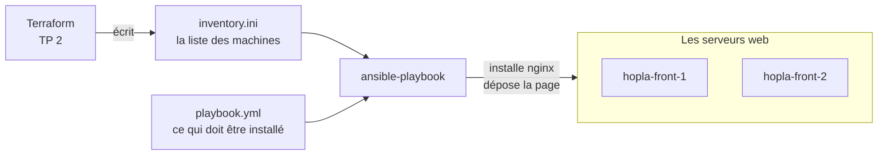
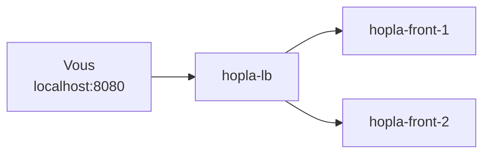

# TP 3 : configurer les serveurs avec Ansible

**Durée : 35 min. Incident :** Terraform a créé les machines, mais le site répond `502`. Qui installe nginx ?

## De quoi s'agit-il ?
Terraform a posé les murs : les serveurs existent, mais ils sont vides. Ansible va entrer dans chacun pour installer et configurer le logiciel, à partir d'un fichier, le playbook.

**Ce que vous allez faire :**
1. Regarder la liste des machines, puis lire le playbook.
2. Le lancer, et voir disparaître le `502`.
3. Le relancer, pour vérifier qu'il ne refait pas ce qui est déjà fait.
4. Changer la page du site sur tous les serveurs, en une seule commande.
5. Arrêter un serveur, puis le remettre en route.



Une fois les serveurs configurés, le chemin d'un client ne change pas :



Dans ce TP, Ansible entre dans les conteneurs par Docker. Sur de vrais serveurs, il passerait par SSH (Secure Shell, la connexion sécurisée à distance). Le playbook resterait le même.

**Où :** toutes les commandes de ce TP se tapent dans le terminal du Codespace.

Avant de commencer, gardez les conteneurs créés au TP 2 : ils doivent être allumés.

### 1. Regarder la liste des machines
**Pourquoi :** Ansible doit savoir où agir. Cette liste s'appelle l'inventaire.
```bash
cd /workspaces/*/labs/03-ansible
cat inventory.ini
```
- `cd /workspaces/*/labs/03-ansible` : se place dans le dossier du TP. Le `*` remplace le nom du dépôt.
- `cat inventory.ini` : affiche le fichier. `[fronts]` est le nom d'un groupe, suivi de ses machines.

**Vous devez voir :** `hopla-front-1` et `hopla-front-2`. Terraform a écrit ce fichier pour Ansible.

### 2. Lire le playbook
**Pourquoi :** comme pour Terraform, on lit avant de lancer.

Ouvrez `labs/03-ansible/playbook.yml`.

| Dans le fichier | Ce que cela veut dire |
|---|---|
| `hosts: fronts` | Agir sur les machines du groupe `fronts` |
| `tasks:` | La liste des tâches, jouées dans l'ordre |
| `name:` | Le nom de la tâche, affiché pendant le lancement |
| `ansible.builtin.apt`, `template`, `service`... | Le module qui fait le travail : installer un paquet, déposer un fichier, gérer un service |
| `notify:` et `handlers:` | Une action lancée seulement si la tâche a changé quelque chose |

**Question :** à quel endroit dit-on ce qu'on veut obtenir, sans dire comment le faire ?

### 3. Lancer le playbook
**Pourquoi :** c'est l'étape qui transforme des serveurs vides en serveurs web.
```bash
ansible-playbook playbook.yml
```
- `ansible-playbook playbook.yml` : joue le playbook sur les machines de l'inventaire. Le fichier `ansible.cfg` du dossier lui indique où trouver cet inventaire.

Comptez une à deux minutes. Pour chaque tâche et chaque serveur, Ansible affiche `ok` (déjà en place) ou `changed` (il vient de le faire). Le bilan final compte ces résultats.

**Vous devez voir :** à la fin, `failed=0` pour chaque serveur.

### 4. Ouvrir le site
**Pourquoi :** on vérifie que le `502` a disparu, et que le load balancer répartit bien les clients.
```bash
for i in 1 2 3 4; do curl -s localhost:8080 | grep Servi; done
```
- `for i in 1 2 3 4; do ...; done` : répète la commande 4 fois.
- `curl -s localhost:8080` : demande la page du site. `-s` masque la barre de progression.
- `| grep Servi` : ne garde que la ligne qui contient `Servi`, celle qui nomme le serveur.

**Vous devez voir :** `hopla-front-1` et `hopla-front-2` à tour de rôle. Le `502` a disparu.

### 5. Relancer sans rien changer
**Pourquoi :** on doit pouvoir relancer sans crainte. C'est ce qu'on appelle l'idempotence : même résultat, quel que soit le nombre de lancements.
```bash
ansible-playbook playbook.yml
```
- `ansible-playbook playbook.yml` : la même commande. Chaque tâche vérifie d'abord l'état du serveur.

**Vous devez voir :** `changed=0` pour chaque serveur.

### 6. Changer la page
**Pourquoi :** un seul fichier à changer, et tous les serveurs suivent. Fini les modifications serveur par serveur.

Ouvrez `labs/03-ansible/templates/index.html.j2`, changez le titre, enregistrez, puis lancez :
```bash
ansible-playbook playbook.yml
curl -s localhost:8080
```
- `ansible-playbook playbook.yml` : redépose la page, car le modèle a changé. Dans ce modèle, `{{ inventory_hostname }}` est remplacé par le nom de chaque serveur.
- `curl -s localhost:8080` : affiche la page en entier.

**Vous devez voir :** seules les tâches liées à la page changent, et votre nouveau titre s'affiche.

### 7. Casser un serveur
**Pourquoi :** avoir deux serveurs ne sert que si le site survit à la perte de l'un d'eux.
```bash
docker stop hopla-front-1
for i in 1 2 3 4; do curl -s localhost:8080 | grep Servi; done
```
- `docker stop hopla-front-1` : arrête ce conteneur, comme si on coupait le serveur.
- `for ...` : la même boucle qu'à l'étape 4.

L'arrêt prend une dizaine de secondes : c'est normal.

**Vous devez voir :** le site répond encore, avec `hopla-front-2` uniquement.

**Question :** comment auriez-vous su qu'un serveur était tombé, sans regarder ?

### 8. Remettre le serveur en route
**Pourquoi :** redémarrer la machine ne suffit pas. Dans ces conteneurs, nginx ne repart pas tout seul.
```bash
docker start hopla-front-1
ansible-playbook playbook.yml
```
- `docker start hopla-front-1` : rallume le conteneur.
- `ansible-playbook playbook.yml` : remet le serveur dans l'état décrit, donc relance nginx.

**Vous devez voir :** `failed=0`. Le playbook a relancé nginx sur `hopla-front-1`.

## Si ça bloque
| Problème | Solution |
|---|---|
| `Could not find or access 'inventory.ini'` | Le TP 2 n'est pas terminé : refaites `terraform apply` dans `labs/02-iac-terraform` |
| `command not found: ansible-playbook` | Fermez le terminal et ouvrez-en un nouveau |
| `Could not resolve` ou erreur sur `apt` | Attendez une minute, puis relancez : le playbook peut être relancé sans danger |
| Le serveur `hopla-front-3` est dans la liste | Remettez `front_count = 2` au TP 2, puis `terraform apply` |
