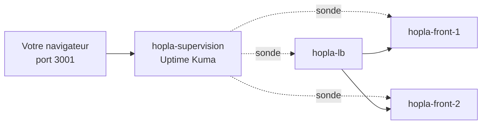

# TP 4 : savoir avant les clients

**Durée : 30 min. Incident :** le site est tombé cette nuit, et Hopla l'a appris par un client.

## De quoi s'agit-il ?
Le site est reconstruit et réparti sur deux serveurs, mais personne ne regarde s'il fonctionne. Nous allons installer un outil qui l'interroge à intervalle régulier : Uptime Kuma. Chaque vérification s'appelle une sonde.

**Ce que vous allez faire :**
1. Démarrer la supervision avec Terraform.
2. Placer une sonde sur le load balancer et une sur chaque serveur.
3. En binôme, provoquer une panne que l'autre doit trouver avec l'interface.
4. Tout casser, comparer les deux pannes, puis remettre le site en route.



La supervision a son propre dossier Terraform, séparé de celui du site. Elle doit pouvoir survivre si le site est détruit.

**Où :** toutes les commandes de ce TP se tapent dans le terminal du Codespace.

Ce TP se fait en binôme. Gardez le site du TP 3 allumé.

### 1. Démarrer la supervision
**Pourquoi :** la supervision est un logiciel comme un autre : on la décrit et on la déploie avec Terraform.
```bash
cd /workspaces/*/labs/04-supervision
terraform init
terraform apply -auto-approve
```
- `cd /workspaces/*/labs/04-supervision` : se place dans le dossier du TP. Le `*` remplace le nom du dépôt.
- `terraform init` : prépare les outils, car c'est un nouveau dossier.
- `terraform apply -auto-approve` : crée l'image et le conteneur. `-auto-approve` évite de taper `yes` : à garder pour un TP ou un script, une fois le code relu.

**Vous devez voir :** `Apply complete! Resources: 2 added`.

### 2. Ouvrir l'interface
**Pourquoi :** Uptime Kuma se pilote depuis une page web, sur le port `3001`.

Dans VS Code, ouvrez l'onglet **Ports**, puis ouvrez la ligne `3001` dans le navigateur. Attendez 20 secondes si la page ne répond pas.

Créez un compte local. Il reste dans votre Codespace : inventez un mot de passe de test.

### 3. Ajouter trois sondes
**Pourquoi :** on surveille ce que voit le client (`hopla-lb`), mais aussi chaque serveur.

Cliquez sur **Ajouter**, gardez le type **HTTP(s)**, et répétez pour chacune de ces adresses :

- `http://hopla-lb`
- `http://hopla-front-1`
- `http://hopla-front-2`

Ces noms fonctionnent parce qu'Uptime Kuma est branché sur le réseau `hopla-front`. C'est pourquoi on n'écrit ni `localhost` ni numéro de port.

**Vous devez voir :** trois sondes vertes, au bout d'une minute.

### 4. Provoquer une panne en binôme
**Pourquoi :** une alerte ne sert que si quelqu'un sait la lire. Votre binôme doit trouver la panne sans voir ce que vous faites.

L'un de vous tourne le dos. L'autre choisit un serveur et l'arrête :
```bash
docker stop hopla-front-1
```
- `docker stop hopla-front-1` : arrête ce serveur. Vous pouvez choisir `hopla-front-2` à la place.

Votre binôme se retourne et cherche la panne, uniquement dans l'interface.

**Vous devez voir :** la sonde du serveur passe au rouge, alors que `hopla-lb` reste vert.

**Question :** le client voit-il cette panne ? Faut-il réveiller quelqu'un ?

### 5. Tout casser
**Pourquoi :** on arrête aussi le dernier serveur, pour comparer avec la panne précédente.
```bash
docker stop hopla-front-2
```
- `docker stop hopla-front-2` : arrête le second serveur. Si vous avez arrêté celui-là à l'étape 4, arrêtez `hopla-front-1`.

**Vous devez voir :** cette fois, `hopla-lb` passe au rouge aussi.

**Question :** quelle différence avec la panne précédente ?

### 6. Remettre le site en route
**Pourquoi :** rallumer les conteneurs ne suffit pas, comme au TP 3 : il faut aussi relancer nginx.
```bash
docker start hopla-front-1 hopla-front-2
cd ../03-ansible
ansible-playbook playbook.yml
```
- `docker start ...` : rallume les deux conteneurs.
- `cd ../03-ansible` : remonte d'un dossier, puis entre dans celui d'Ansible.
- `ansible-playbook playbook.yml` : relance nginx sur les deux serveurs.

**Vous devez voir :** les trois sondes redevenir vertes au bout d'une minute.

## Si ça bloque
| Problème | Solution |
|---|---|
| `network hopla-front not found` | Le TP 2 n'est plus en place : relancez `terraform apply` dans `labs/02-iac-terraform` |
| La ligne `3001` n'apparaît pas | Ajoutez le port à la main dans l'onglet **Ports** |
| Une sonde reste rouge | Vérifiez l'adresse : elle doit commencer par `http://`, sans numéro de port |
