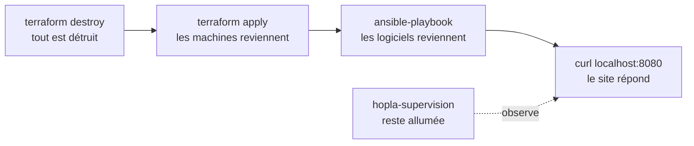

# Finale : tout reconstruire

**Durée : 15 min. Incident :** tout a brûlé. Combien de temps pour tout reconstruire ?

## De quoi s'agit-il ?
Au début du cours, personne ne savait comment Hopla était installé. Maintenant, tout est écrit. Nous allons le prouver : tout détruire, tout reconstruire avec une seule commande, et mesurer le temps.

**Avant de lancer :** gardez l'interface d'Uptime Kuma ouverte, pour voir les sondes passer au rouge, puis revenir au vert.



## Lancer la finale
**Où :** dans le terminal du Codespace.
```bash
bash /workspaces/*/labs/finale.sh
```
- `bash` : lance le script `labs/finale.sh`, qui enchaîne les commandes ci-dessous. Le `*` remplace le nom du dépôt.

## Ce que fait le script
Ces commandes sont celles des TP 2 et 3. Vous n'avez pas à les taper.

| Dans `labs/finale.sh` | Ce qu'elle fait |
|---|---|
| `docker network disconnect -f hopla-front hopla-supervision` | Détache la supervision du réseau du site, pour que ce réseau puisse être détruit |
| `terraform -chdir=... destroy -auto-approve` | Détruit tout ce que le TP 2 a créé. `-chdir` indique le dossier du TP, et `-auto-approve` évite de taper `yes` |
| `terraform -chdir=... apply -auto-approve` | Recrée les réseaux et les conteneurs à partir du code |
| `docker network connect hopla-front hopla-supervision` | Rebranche la supervision sur le nouveau réseau |
| `ansible-playbook playbook.yml` | Réinstalle nginx et la page sur les serveurs |
| `curl -fsS localhost:8080` | Vérifie que le site répond. `-f` fait échouer le script en cas d'erreur, et `-sS` n'affiche que le résultat ou l'erreur |

**Vous devez voir :** la page du site, puis `Hopla Market reconstruit en ... secondes.`

**Comment lire le résultat :** ces lignes arrivent dans cet ordre, au milieu d'un long défilement.

```text
Destroy complete! Resources: 10 destroyed.
...
Apply complete! Resources: 10 added, 0 changed, 0 destroyed.
...
PLAY RECAP *********************************************************************
hopla-front-1              : ok=6    changed=5    unreachable=0    failed=0    skipped=0    rescued=0    ignored=0
hopla-front-2              : ok=6    changed=5    unreachable=0    failed=0    skipped=0    rescued=0    ignored=0

<h1>Hopla Market</h1>
<p>Servi par hopla-front-1</p>

Hopla Market reconstruit en 21 secondes.
```
- `10 destroyed` : tout ce que Terraform gère a disparu.
- `10 added` : tout est revenu, à partir du code.
- `changed=5`, `failed=0` : Ansible a tout réinstallé sur des serveurs vides.
- `<h1>Hopla Market</h1>` : le site répond.
- La dernière ligne donne votre temps. Le nôtre n'est qu'un exemple : le vôtre dépendra de la machine.

**Question :** combien de temps auriez-vous mis sans ces fichiers ? Et que manque-t-il encore pour une vraie reprise après un incendie ?
